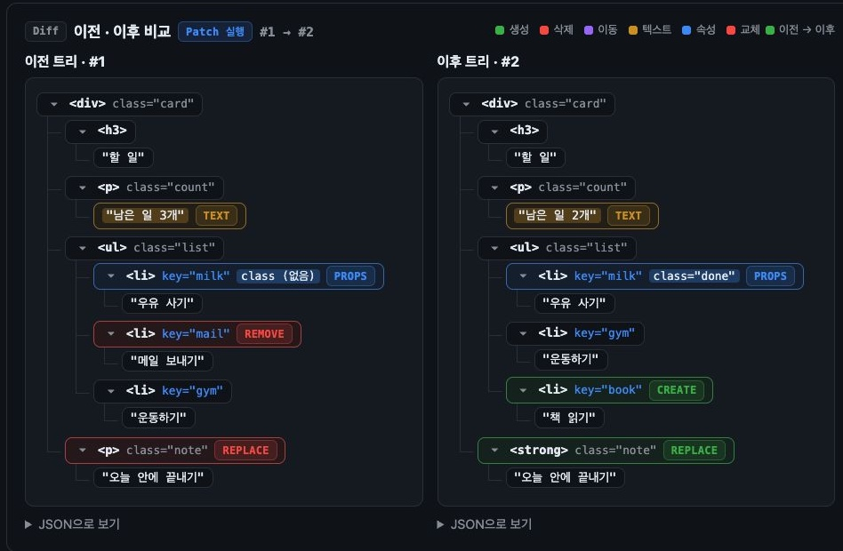
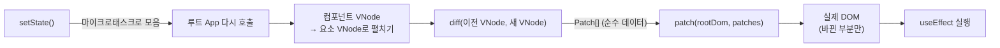

# jungle-mini-react

jungle 13기 **Mini React** 레포지토리입니다.
React, Vue 같은 UI 프레임워크 없이 **순수 JavaScript**로 React의 핵심 동작인 Virtual DOM, Diff, Patch, 컴포넌트, Hooks를 직접 구현했습니다.

- **런타임 의존성 0개**: Vite·Vitest·jsdom은 개발 도구(`devDependencies`)로만 씁니다.
- **데모 사이트도 직접 만든 Mini React로 그립니다**: [`src/app`](src/app)은 HTML, 바닐라 JS, `src/lib`만 사용합니다.

## 라이브 데모

Diff · Patch 시각화에서 변경 전후의 Virtual DOM 트리를 비교하고, 컴포넌트 데모에서 상태와 Hook의 변화를 확인할 수 있습니다.

[](https://1224kang.github.io/jungle-mini-react/)

[라이브 데모 열기](https://1224kang.github.io/jungle-mini-react/)

<br/>

## ✨ 구현 기능

### Phase 1: Virtual DOM · Diff · Patch

- [x] `h(type, props, ...children)`: VNode 생성과 정규화
- [x] `domToVdom(node)`: 실제 DOM → VNode 변환 (공백·주석 정리, `data-key` → `key`)
- [x] `render(vnode)`: VNode → 실제 DOM
- [x] `diff(old, new)`: 두 VNode를 비교해 `Patch[]` 계산 (DOM에 접근하지 않는 순수 함수)
- [x] `patch(rootDom, patches)`: 바뀐 부분만 실제 DOM에 반영
- [x] Patch 6종: `CREATE`, `REMOVE`, `REPLACE`, `TEXT`, `PROPS`, `MOVE`
- [x] key 기반 자식 비교 (React식 `lastPlacedIndex`)
- [x] `on*` 함수 prop → `addEventListener`, 교체·제거 시 이전 리스너 정리

### Phase 2: 컴포넌트 · State · Hooks

- [x] 함수형 컴포넌트 (`h(Counter, props)`), diff 전에 요소 VNode로 펼치기
- [x] `FunctionComponent`와 `mount`: 루트 컴포넌트의 `hooks` 배열, `mount()`, `update()`, `unmount()`
- [x] `useState`: 같은 작업 안의 상태 변경을 마이크로태스크로 모아 **한 번만** 다시 그림
- [x] `useEffect`: DOM 반영 직후 실행, 다시 실행하기 전과 `unmount` 때 정리 함수 호출
- [x] `useMemo`: 의존성이 같으면 이전 값 재사용
- [x] Hook 규칙 검사: 루트 밖에서 호출, 렌더마다 Hook 순서가 바뀜, effect로 인한 무한 갱신을 에러로 알림

<br/>

## ⚙️ 동작 원리



1. **상태 변경**: `setState`를 여러 번 불러도 마이크로태스크 하나로 모아 렌더는 1번만 합니다. 같은 값으로 바꾸면 다시 그리지 않습니다.
2. **VNode 생성**: 루트 컴포넌트를 다시 호출하고, 자식 컴포넌트는 요소 VNode로 펼칩니다. 그래서 `diff`·`patch`는 Phase 1 그대로 씁니다.
3. **Diff**: 이전 VNode와 새 VNode를 같은 레벨끼리 비교해 `Patch[]`를 만듭니다. DOM을 읽지도 쓰지도 않습니다.
4. **Patch**: 모든 경로를 먼저 DOM 참조로 바꾼 뒤, 참조로만 DOM을 조작합니다.

<br/>

## 🔍 핵심 구현 포인트

### 1. Patch는 "이전 트리 기준 경로 + 실행 전 일괄 해석"

`path`는 이전(old) VNode 트리 기준 자식 인덱스 배열입니다. `patch`는 DOM을 바꾸기 **전에** 모든 경로를 DOM 참조로 해석해 두므로, 앞에서 노드를 지우거나 옮겨도 뒤의 대상이 흔들리지 않습니다. 해석에 실패하면 DOM을 하나도 바꾸지 않고 에러를 던집니다(부분 적용 없음).

VNode에 DOM 참조(`vnode.el`)를 저장하는 React·Vue 방식 대신 이 방식을 고른 이유는, VNode와 Patch를 **순수 데이터**로 유지해 `toEqual` 기반 테스트와 팀 데이터 계약을 지키기 위해서입니다.

### 2. key 기반 자식 비교 (lastPlacedIndex)

같은 `type` + `key`인 자식은 DOM을 재사용하고, 재사용한 old 인덱스가 `lastPlacedIndex`보다 작을 때만 `MOVE`합니다. 배치는 새 순서의 **뒤에서부터** 해서 각 노드를 "바로 다음 형제 앞"에 넣으면 최종 위치가 됩니다.

| `[A,B,C,D]` → | 이동 | 삽입 | 삭제 |
|---|---|---|---|
| 맨 앞 추가 `[E,A,B,C,D]` | 0 | 1 | 0 |
| 중간 삭제 `[A,B,D]` | 0 | 0 | 1 |
| 맨 앞 → 맨 뒤 `[B,C,D,A]` | 1 | 0 | 0 |
| 맨 뒤 → 맨 앞 `[D,A,B,C]` | 3 | 0 | 0 |

마지막 줄은 lastPlacedIndex의 알려진 약점(최소 이동을 보장하지 않음)이며, 의도된 동작으로 테스트에 고정했습니다.

### 3. 복잡도

- `diff`: 평균 **O(N + P)** (N = 노드 수, P = 속성 수). "같은 레벨끼리만 비교", "type이 다르면 하위는 비교하지 않음" 휴리스틱 덕분입니다.
- `patch`: 해석 **O(K·d)** (K = Patch 수, d = 트리 깊이), 실행은 Patch당 DOM 호출 O(1).

### 4. Hook은 루트 컴포넌트에서만

상태와 Hook은 `mount`한 루트 컴포넌트에만 두고, 자식 컴포넌트는 props만 받는 순수 함수로 둡니다(Lifting State Up). 자식이나 이벤트 핸들러에서 Hook을 부르면 에러가 납니다.

### 기능
- **key 기반 이동(MOVE)**: 5가지 기본 케이스에 더해, 순서만 바뀐 자식은 다시 만들지 않고 옮깁니다.
- **Batching (선택 과제)**: 한 작업 안의 setState를 마이크로태스크 하나로 모아 렌더 1번. 같은 값이면 렌더 0번.
- **unmount와 effect 정리**: `FunctionComponent.unmount()`가 cleanup을 선언 순서대로 실행합니다.
- **Hook 규칙 런타임 검사**: 루트 밖 호출, Hook 순서 변경, 렌더 중 setState, effect 무한 갱신을 에러로 알립니다.

### 최적화
| 기법 | 효과 |
|---|---|
| key로 DOM 재사용 + MOVE | 순서 변경 시 재생성 없이 이동만 |
| 같은 위치 교체는 REPLACE 1건 | REMOVE + CREATE 대신 조작 1번 |
| type이 다르면 하위 비교 생략 | diff 평균 O(N + P) |
| 바뀐 속성만 반영, 같은 핸들러는 그대로 | 변경 없으면 DOM 조작 0회 |
| batching + 같은 값 건너뛰기 | setState N번 → 렌더 1번 |

> 세부 규칙: [docs/contracts.md](docs/contracts.md) (VNode·Patch·컴포넌트 데이터 계약), [docs/diff-patch.md](docs/diff-patch.md) (Diff·Patch 설계 배경)

<br/>

## 🧩 사용 예

```js
import { h, mount, useState, useEffect } from './src/lib/index.js';

// 자식: 상태 없이 props만 쓰는 순수 함수
function Counter({ count, onInc }) {
  return h('button', { onclick: onInc }, `count: ${count}`);
}

// 루트: 상태와 Hook은 여기에만 둡니다
function App() {
  const [count, setCount] = useState(0);
  useEffect(() => { document.title = `count: ${count}`; }, [count]);

  const incThree = () => {
    setCount((c) => c + 1);
    setCount((c) => c + 1);
    setCount((c) => c + 1);
  }; // 3번 바꿔도 렌더는 1번
  return h(Counter, { count, onInc: incThree });
}

const app = mount(h(App), document.getElementById('app'));
// app.hooks: Hook 상태, app.update(): 즉시 다시 그리기, app.unmount(): 내리기
```

컴포넌트 없이 Phase 1 API만 쓸 수도 있습니다.

```js
import { h, render, diff, patch } from './src/lib/index.js';

let prev = h('ul', null, h('li', { key: 'a' }, 'A'), h('li', { key: 'b' }, 'B'));
let root = render(prev);
container.appendChild(root);

const next = h('ul', null, h('li', { key: 'b' }, 'B'), h('li', { key: 'a' }, 'A'));
root = patch(root, diff(prev, next)); // 루트가 교체될 수 있으니 반환값을 다시 받습니다
prev = next;
```

### 공개 API

모든 외부 코드는 [`src/lib/index.js`](src/lib/index.js)에서만 import합니다.

| API | 설명 |
|---|---|
| `h(type, props, ...children)` | VNode 생성. `type`이 함수면 컴포넌트 VNode |
| `domToVdom(node)` | 실제 DOM → VNode |
| `render(vnode)` | VNode → 실제 DOM 노드 |
| `diff(oldVNode, newVNode)` | `Patch[]` 계산 |
| `patch(rootDom, patches)` | Patch 적용, 패치 후 루트 DOM 반환 |
| `mount(vnode, container)` | 앱 마운트. 컴포넌트면 `FunctionComponent` 인스턴스 반환 |
| `FunctionComponent` | 루트 컴포넌트 클래스 (`hooks`, `mount()`, `update()`, `unmount()`) |
| `useState(initial)` | `[state, setState]` |
| `useEffect(fn, deps)` | DOM 반영 후 실행되는 effect |
| `useMemo(fn, deps)` | 의존성이 같으면 이전 값 재사용 |

<br/>

## 🖥️ 데모 사이트

`npm run dev` 후 아래 주소로 접속합니다. 사이트 전체가 Mini React로 그려집니다.

| 페이지 | 주소 | 내용 |
|---|---|---|
| 홈 | http://localhost:5173/ | Phase 1·2 소개와 라이브 데모 |
| Diff · Patch 시각화 | http://localhost:5173/src/app/visualizer/ | 화면을 직접 고치고 Patch를 실행해 Patch 목록, 바뀐 DOM 노드, 이전·이후 VNode 트리, 실행 기록을 확인 |
| 컴포넌트 · Hooks 인스펙터 | http://localhost:5173/src/app/components/ | 장바구니 데모로 컴포넌트 트리, Hook 슬롯(`app.hooks`), 렌더 기록을 관찰 |
| Patch 검증 페이지 (개발용) | http://localhost:5173/src/playground/verify/ | HTML을 입력해 diff/patch 결과가 새 VNode와 일치하는지 검사 |

<br/>

## 📂 프로젝트 구조

```
jungle-mini-react/
├─ index.html              # 페이지 목록 (/index.html). `/`는 데모 사이트(src/app)를 보여 줌
├─ vite.config.js          # vitest 환경(jsdom), 개발 서버 `/` → src/app
├─ docs/
│  ├─ contracts.md         # VNode / Patch / 컴포넌트 데이터 계약
│  └─ diff-patch.md        # diff / patch 설계 배경과 세부 규칙
├─ fixtures/
│  └─ cases.js             # diff/patch 검증용 before/after 케이스
├─ src/
│  ├─ lib/                 # Mini React 본체
│  │  ├─ index.js          # 공개 인터페이스
│  │  ├─ shared/           # 상수(NODE_TYPE, PATCH_TYPE, HOOK_TYPE), 에러, 헬퍼
│  │  ├─ vdom/             # h, domToVdom, normalize, expand(컴포넌트 펼치기)
│  │  ├─ dom/              # render, props(속성·이벤트 리스너)
│  │  ├─ reconcile/        # diff(변경 계산), patch(DOM 반영)
│  │  └─ hooks/            # useState·useEffect·useMemo, FunctionComponent·mount
│  ├─ app/                 # 데모 사이트 (HTML + 바닐라 JS + src/lib만 사용)
│  │  ├─ shared/           # 공용 레이아웃·사이드바·라우트·스타일
│  │  ├─ visualizer/       # Diff · Patch 시각화
│  │  └─ components/       # 컴포넌트 · Hooks 인스펙터
│  └─ playground/          # 개발용 검증 페이지 (verify/)
├─ tests/                  # lib 구조를 따르는 테스트 + app·playground 테스트
├─ scripts/                # 보조 스크립트
├─ Dockerfile
├─ compose.yaml
└─ package.json
```

### 설계 원칙

1. **정보 은닉**: 외부(app, playground, 통합 테스트)는 `src/lib/index.js`에서만 import합니다.
2. **관심사 분리**: `vdom`은 VNode 생성·변환, `dom`은 VNode → DOM, `reconcile/diff`는 변경 계산, `reconcile/patch`는 DOM 반영을 맡습니다.
3. **낮은 결합도**: `diff.js`는 DOM API와 `dom/`을 쓰지 않는 순수 함수입니다.
4. **의존성 방향**: app·playground → `lib/index.js` → hooks → vdom·dom·reconcile → shared. 역방향 import는 금지하며 [`tests/boundaries.test.js`](tests/boundaries.test.js)가 검사합니다.

<br/>

## 🛠️ 기술 스택

| 구분 | 사용 |
|---|---|
| 언어 | JavaScript (ES Module) |
| 런타임 | Node.js 24 (Docker `node:24-slim`) |
| 개발 서버 | [Vite](https://vite.dev/) |
| 테스트 | [Vitest](https://vitest.dev/) + [jsdom](https://github.com/jsdom/jsdom) |
| 개발 환경 | Docker, Docker Compose |

<br/>

## 🚀 시작하기

모든 팀원은 **Docker 컨테이너 안에서** 개발합니다. 로컬에 Node.js를 설치할 필요가 없습니다.

### 1. 사전 준비

[Docker Desktop](https://www.docker.com/products/docker-desktop/)을 설치하고 실행합니다.

```bash
docker --version
docker compose version
```

### 2. 저장소 클론 & 이미지 빌드

```bash
git clone https://github.com/1224kang/jungle-mini-react.git
cd jungle-mini-react
docker compose build
```

빌드할 때 `package-lock.json` 기준으로 패키지가 자동 설치됩니다.

### 3. 컨테이너 접속 & 실행

```bash
docker compose run --rm --service-ports dev
```

프롬프트가 `node@xxxx:/app$`로 바뀌면 컨테이너 안입니다. 이어서 개발 서버를 띄웁니다.

```bash
npm run dev
```

- `npm`, `node` 명령은 **모두 컨테이너 안에서** 실행합니다.
- 코드는 로컬 에디터(VS Code 등)에서 수정하면 컨테이너에 바로 반영됩니다.
- `--service-ports`를 붙여야 브라우저에서 `localhost:5173`으로 접속할 수 있습니다.
- 나갈 때는 `exit`를 입력합니다. 컨테이너는 자동으로 삭제되고, 설치한 패키지는 볼륨에 남습니다.

### npm 스크립트

| 명령어 | 설명 |
|---|---|
| `npm run dev` | 개발 서버 실행 → http://localhost:5173 |
| `npm test` | 테스트 감시 모드 (파일 저장 시 자동 재실행) |
| `npm run test:run` | 테스트 1회 실행 (PR 전 확인용) |
| `npx vitest run tests/reconcile/diff.test.js` | 특정 테스트 파일만 실행 |

dev 서버를 띄운 채로 테스트를 돌리려면 로컬에서 새 터미널을 열고 컨테이너를 하나 더 실행합니다. `--service-ports`를 빼야 5173 포트가 겹치지 않습니다.

```bash
docker compose run --rm dev npm test
```

<br/>

## ✅ 테스트

Vitest + jsdom으로 31개 테스트 파일을 돌립니다.

| 영역 | 위치 | 검증 내용 |
|---|---|---|
| VNode | `tests/vdom/` | `h`·`domToVdom` 정규화가 데이터 계약과 일치하는지, 컴포넌트 펼치기 |
| 렌더 | `tests/dom/` | VNode → DOM 변환 |
| Diff · Patch | `tests/reconcile/` | Patch 종류별 동작, props·이벤트, DOM 객체 재사용(`===`), 에러 시 부분 적용 없음, keyed children 이동·배치 |
| Hooks | `tests/hooks/` | `useState`·`useEffect`·`useMemo`, 배칭, mount·unmount, Hook 규칙 |
| 경계 | `tests/boundaries.test.js` | 의존성 방향, `diff`의 DOM 비의존 |
| 데모·검증 페이지 | `tests/app/`, `tests/playground/` | 시각화 엔진·기록, HTML 왕복, patch 일치 |

핵심 판정 기준은 **`domToVdom(patch 후 DOM)`이 새 VNode와 `toEqual`인지**입니다.

<br/>

## 🤝 협업 규칙

<details>
<summary>작업 흐름 · 브랜치 · 커밋 · 패키지 관리</summary>

### 작업 흐름

1. 이슈 생성 (기능 / 버그 / 작업 템플릿 선택)
2. `develop`에서 브랜치 생성
3. 작업 후 컨테이너 안에서 `npm run test:run` 통과 확인
4. `develop`으로 PR 생성 (템플릿 작성, `Closes #이슈번호` 포함)
5. 팀원 리뷰 승인 후 머지

### 브랜치 이름

```
<종류>/<작업-내용>
```

| 종류 | 용도 | 예시 |
|---|---|---|
| `feat` | 기능 구현 | `feat/diff-algorithm` |
| `fix` | 버그 수정 | `fix/patch-text-node` |
| `refactor` | 동작 변화 없는 코드 개선 | `refactor/vdom-structure` |
| `test` | 테스트 추가·수정 | `test/use-state` |
| `docs` | 문서 | `docs/readme` |
| `chore` | 환경·설정 | `chore/docker-dev-env` |

### 커밋 메시지

```
<종류>: <변경 내용 요약>
```

```
feat: diff 함수에서 텍스트 노드 비교 구현
fix: patch 시 props가 제거되지 않는 문제 수정
chore: vitest jsdom 환경 설정 추가
```

종류는 브랜치 이름과 같은 규칙(`feat`, `fix`, `refactor`, `test`, `docs`, `chore`)을 사용합니다.

### 패키지 관리

- 패키지는 **반드시 컨테이너 안에서** 설치합니다. 로컬 터미널에서 `npm install`을 실행하지 않습니다.
- 패키지 추가는 **팀 합의 후** 진행하며, 외부 UI 프레임워크(React, Vue, Svelte 등)는 사용하지 않습니다.
- 개발 도구는 `npm install -D <패키지명>`으로 `devDependencies`에 추가합니다.
- `package.json`과 `package-lock.json`은 **항상 함께 커밋**합니다.
- 다른 팀원이 패키지를 추가했다면 `git pull` 후 컨테이너 안에서 `npm install`을 실행합니다.

</details>

<br/>

## 👥 팀원

<!-- TODO: 팀원 이름·GitHub·맡은 부분 채우기 -->

| 이름 | GitHub | 맡은 부분 |
|---|---|---|
|  |  |  |
|  |  |  |
|  |  |  |
